# Lebanon Wildfire-Risk Predictor

Predicts next-day wildfire risk for every ~5 km grid cell across Lebanon and shows it on a live map.

## Project Status

🚧 **In progress — Day 14 of 18 complete**

| Day | Task | Status |
|----|------|--------|
| 1 | Setup (repo, venv, structure) | ✅ Done |
| 2 | Fire data (NASA FIRMS) | ✅ Done |
| 3 | Lebanon grid (~5 km cells) | ✅ Done |
| 4 | Weather data (Open-Meteo) |  ✅ Done |
| 5 | Vegetation (NDVI) + terrain | ✅ Done |
| 6 | Exploratory data analysis | ✅ Done |
| 7 | Feature engineering | ✅ Done |
| 8 | Baseline model + MLflow | ✅ Done |
| 9 | LightGBM model |  ✅ Done |
| 10 | Spatial/time validation | ✅ Done |
| 11 | Optuna tuning | ✅ Done |
| 12 | SHAP explainability | ✅ Done |
| 13 | FastAPI service | ✅ Done |
| 14 | Docker | ✅ Done |
| 15 | Daily pipeline | ⏳ Next |
| 16 | Streamlit live map | ⬜ |
| 17 | Deploy | ⬜ |
| 18 | README + showcase | ⬜ |

## Data Sources
- **NASA FIRMS**: satellite fire detections (VIIRS, 375 m)
- **geoBoundaries**: Lebanon's country border
- **Open-Meteo**: daily historical weather
- **MODIS NDVI** (Terra + Aqua, 250 m, 16-day composites) via Microsoft Planetary Computer: vegetation greenness; the Jun–Nov 2025 catalog gap filled from **NASA AppEEARS**
- **Copernicus DEM** (90 m) via Microsoft Planetary Computer: elevation and terrain

## Stack
Python 3.12 · pandas · geopandas · xarray · rioxarray · odc-stac · matplotlib · Jupyter · pytest · scikit-learn · LightGBM · MLflow · Optuna · SHAP · FastAPI · Docker · Streamlit

## Setup
1. `py -3.12 -m venv .venv`
2. `.\.venv\Scripts\Activate.ps1`
3. `pip install -r requirements.txt`
4. Copy `.env.example` to `.env` and add your NASA FIRMS MAP_KEY
5. `python src\check_setup.py`
6. *(For the container)* install Docker Desktop with the WSL 2 engine

## What's Built So Far

### Fire data (Day 2)
- Satellite: VIIRS S-NPP (375 m resolution)
- Archive (`VIIRS_SNPP_SP`) from Jan 2012, near-real-time (`VIIRS_SNPP_NRT`) for recent months
- Area: Lebanon bounding box (35.10–36.63°E, 33.05–34.70°N)
- Cleaning: kept vegetation fires only, removed low-confidence and duplicate detections
- Result: **13,447 detections** on 3,270 fire days (2012–2026)
- Fire season peaks June–October

### Lebanon grid (Day 3)
- Splits Lebanon into **488 cells of 5 × 5 km**, built in a meter-based projection (UTM 36N)
- Each cell stores `land_frac`, the share of the cell inside Lebanon (coastal and border cells are partial)
- Each cell gets one lat/lon point placed on land, used to fetch its weather
- **9,527 fire detections** matched to their cells; 3,920 outside Lebanon removed (mostly Syrian farmland inside the bounding box)
- **Persistent hotspot filter:** spots detected in ≥ 6 years *and* ≥ 8 calendar months are flagged as likely industrial heat sources (e.g. coastal power plants and cement works), not wildfires. That's 959 detections, kept but flagged.
- Fire is rare, so later models are judged with PR-AUC and recall, not accuracy (exact target rate in Day 6)

### Weather data (Day 4)
- Source: Open-Meteo Historical Weather API, daily values from **2012-01-25 to 2026-10-29** (same range as the fire data)
- 7 fire-weather variables: max temperature, min relative humidity, precipitation, max wind speed, max wind gusts, FAO evapotranspiration, max vapour pressure deficit
- **Key decision: a 0.1° weather grid instead of 488 cells.** Open-Meteo's historical model has a grid point about every 10 km, so neighbouring 5 km cells get the same weather anyway. Each cell is snapped to its nearest 0.1° point, giving **126 weather points** (~3.9 cells each). The data quality is the same, and the API cost drops from ~131k to ~34k calls.
- **Resumable download:** 90 batches (15 years × 6 groups of 21 points), each saved as soon as it arrives. Every run skips finished batches, stops below the 10,000 calls/day free limit, paces requests under the hourly limit, and retries failures. **Completed Nov 3, 2026:** all 90 batches, 2,631,296 cell-days (488 cells × 5,392 days), no missing values.
- Output: `data/processed/weather_daily.parquet`, one row per cell per day (~2.6M rows when complete)
- Sanity check: hot, dry summers (Jul–Aug max ≈ 30°C, near-zero rain Jun–Sep), wet winters, vapour pressure deficit peaking in the fire season, and much colder winters at high inland cells than on the coast

### Vegetation + terrain (Day 5)

**Vegetation (NDVI)**
- Source: MODIS 250 m 16-day NDVI from **both Terra and Aqua**, searched through the Planetary Computer STAC catalog: **663 composites, Nov 2011 – Sep 2026**
- Terra and Aqua composites are offset by 8 days, so combining them gives a **fresh NDVI value every 8 days** instead of every 16
- Lebanon sits on the border of two MODIS tiles (h20v05, h21v05); both are stitched and reprojected onto one fixed 250 m UTM grid
- **Fast per-cell averaging:** grid cells (clipped to Lebanon's border) are rasterized onto the pixel grid once, so each date's per-cell mean is a single `numpy.bincount` instead of 488 polygon clips
- Reprocessed duplicate images are removed (newest version kept per date and tile)
- **Parallel, resumable download:** a thread pool processes several dates at once; each date is saved as its own file and finished dates are skipped on rerun, so crashes and expired download links cost nothing
- **Leakage guard:** every value gets an `available_date` = composite end date + 3 days (NASA's processing lag), so the model never uses vegetation data before it actually existed
- Data quality: only **0.9% missing** (clouds); 3 tiny coastal sliver cells never covered; **catalog gap from 2025-06-26 to 2025-11-17** (most of the 2025 fire season). It was first handled with forward-filling plus an "NDVI age" feature, then **filled on Nov 5, 2026** with the missing composites from NASA AppEEARS (same MOD13Q1 + MYD13Q1 product): the maximum NDVI age in 2025 dropped from ~167 to 31 days (a few cloudy cells waiting for the next clear composite, within the all-years maximum of 63).
- Seasonal cycle: NDVI peaks in **April–May (~0.40)** and is lowest in **August–September (~0.30)**, right when fires peak

**Terrain**
- Source: Copernicus DEM 90 m, reprojected to UTM 36N (meters), so slope math is correct
- Slope and aspect computed from elevation gradients; aspect turned into **northness** (+1 north-facing, −1 south-facing) and **eastness**
- Per-cell features: mean / max / std elevation, mean / max slope, mean northness, mean eastness, and **`south_steep_frac`**: the share of a cell that is both steep (> 10°) and south-facing. These are the sunniest, driest slopes.
- Sanity check: highest cell max ≈ 3,080 m (Qurnat as Sawda, 3,088 m); slopes mostly face west, toward the sea, as expected for Mount Lebanon

**Outputs:** `data/processed/ndvi.parquet` (one row per cell per composite), `data/processed/terrain.parquet` (one row per cell)

### Exploratory data analysis (Day 6)

Notebook: [`notebooks/06_eda.ipynb`](notebooks/06_eda.ipynb) · Charts: `reports/figures/`

The target is **"fire in this cell tomorrow"** on a table of **488 cells × 5,391 days = 2.63M cell-days**. Weather results use 2012–2015 for now and will be rerun once the download completes.

**Key findings**
1. **Extreme imbalance:** only **0.20%** of cell-days have a fire the next day (1 : 494). A model that always says "no fire" is 99.8% accurate and useless → PR-AUC and recall in the top-ranked cells, never accuracy.
2. **Industrial hotspots confirmed:** the 959 flagged detections burn all year (flat monthly profile), while real wildfires peak Jul–Oct. The busiest spots sit on power plants and cement factories (Deir Ammar, Zahrani, Chekka, Jiyeh) → excluded from the target.
3. **Season:** Jun–Oct. Burning cell-days peak in September, while detections per fire peak in October (bigger fires). The season is ~4× riskier, but still 99.6% negative. No weekday effect (~1.04×).
4. **Conflict-driven shift:** the south is 13% of cells and ~20% of fire days in normal years, but **47% in 2024** (154 southern fire days in Oct 2024 alone) and **50% in 2026** (4–10× normal every month Jun–Sep). These spikes are not explained by season → metrics will be reported separately by region and period.
5. **Fires cluster:** fire today → **30×** risk tomorrow, fire in the last 7 days → 11×, burning neighbour → 7×. But **~3/4 of next-day fires start in quiet cells**, so weather, vegetation and terrain must do most of the work.
6. **Elevation** is the strongest static signal (Spearman −0.67): low cells burn ~25× more than the highest. Slope is mostly confounded with elevation; south-facing steep share shows no clear link on its own (kept for the model to judge).
7. **Vegetation is a hump:** medium NDVI burns ~10× more than bare land and ~2× more than the greenest cells (fuel-limited vs moisture-limited) → favours tree models over linear ones.
8. **Weather works as anomalies, not raw values:** raw weather mostly reflects geography (cool = mountains, humid = coast). Compared with each cell's own monthly normal, **humidity below normal → 3.7× more fires**, and VPD / evapotranspiration above normal → ~2.5×.
9. **Data quality:** the FIRMS archive → near-real-time switch (Aug 2026) is safe (same detections per fire day and same intensity). Mostly-sea cells burn less while half-land coastal cells burn most → `land_frac` becomes a feature.

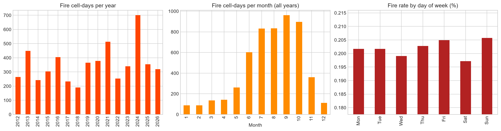
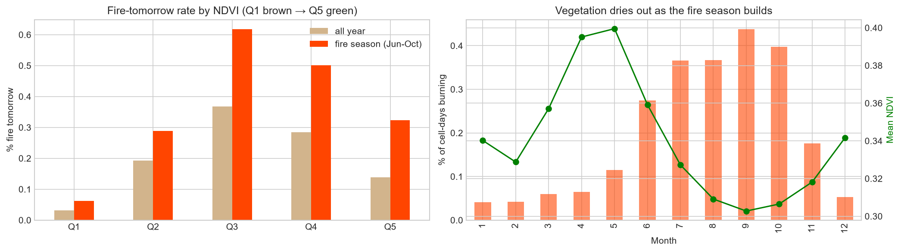
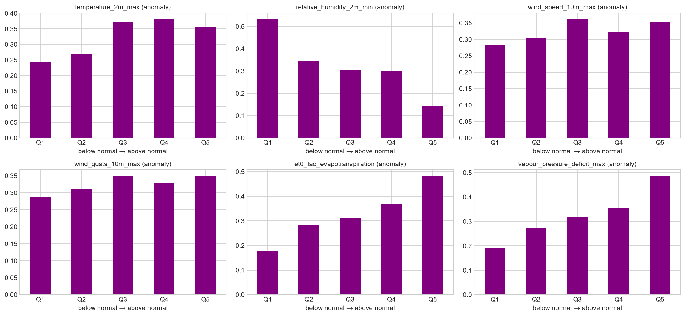

**What this decides for the next days**
- **Day 7 features:** fire history (today, last 3/7 days, burning neighbours, past fire rate per cell), weather anomalies against a past-only normal, days since last rain, latest NDVI + NDVI age + drop from spring peak, terrain, `land_frac`, cyclical day of year
- **Day 8 baseline to beat:** "fire today → fire tomorrow"
- **Imbalance:** class weights, no resampling before the split
- **Day 10 validation:** train on earlier years, test on later ones, with scores split by south vs rest and war vs normal periods

### Feature engineering (Day 7)

Script: [`src/features.py`](src/features.py) · Tests: [`tests/test_features.py`](tests/test_features.py) · Check notebook: [`notebooks/07_features_check.ipynb`](notebooks/07_features_check.ipynb)

One row per **cell × day** (488 cells × 5,392 days ≈ **2.63M rows**, 52 features). The label `fire_tomorrow` = 1 if the cell has a non-industrial fire detection on day t+1 (hotspots excluded). Positive rate: **0.20%**. Each cell's last day has no label; those are the rows the daily pipeline will predict.

**Leakage rule:** a feature for day *t* uses only data available by the end of day *t*.
- Rolling windows only look back; per-cell fire rate and NDVI monthly normals use **past days and past years only**
- NDVI is joined with an **as-of join** (`merge_asof`) on its publication date (end date + 3 days), never its start date
- A **pytest leakage test** builds features from synthetic data, adds fires in the future, and asserts that every earlier row stays identical. 7 tests in total (label = next-day fire, no duplicates, complete grid, NDVI never from the future, feature list matches the file).

| Group | Features | Signal (lift vs average) |
|---|---|---|
| Fire history | fires in last 7/30/365 days, days since last fire, past-only cell fire rate, today's detections and fire power | Recently burned cells: **~4.4×** |
| Neighbours | neighbour fires today and in the last 7 days, number of neighbours | 1 burning neighbour **3.2×** · 2–3 **6×** · 4+ **~20×** |
| Weather | daily max temp, min humidity, VPD, wind, gusts, ET0; 3/7-day means; 7/30/90-day rain; dry streak; 30-day ET0; **anomalies vs the cell's past-only monthly normal** (temp, humidity, VPD, ET0) | Hottest weeks **~2.5×**, longest dry streaks **~3.2×**; anomaly signal to be rechecked once all 15 years are downloaded |
| Vegetation | latest published NDVI, its age, 30-day change, anomaly vs the cell's past monthly normal | Fast browning **~1.5×**; `ndvi_age_days` flags the 2025 gap (up to ~150 days old) |
| Terrain + calendar | elevation, slope, aspect, south-steep share, land share, month, day-of-year (sin/cos), weekday | September fire rate **~10×** January |

**Engineering choices**
- **Neighbour counts by matrix multiplication:** fires as a days × cells matrix times a 488 × 488 adjacency matrix gives every cell's neighbour fires for every day in one operation, instead of merging ~20M rows
- **One reusable script, not a notebook:** the same code will run in the Day 15 daily pipeline; `feature_columns.json` stores the exact feature list so training and the API always use the same columns
- **Excluded on purpose:** `year` (can't generalize to future years) and raw lat/lon (lets the model memorize places instead of learning drivers; `cell_fire_rate` carries the "this place burns" signal from the past only)
- **Honest finding:** `south_steep_frac` falls at the top end, because the steepest cells are high, rocky slopes with little fuel; it's confounded with elevation, which SHAP will untangle on Day 12

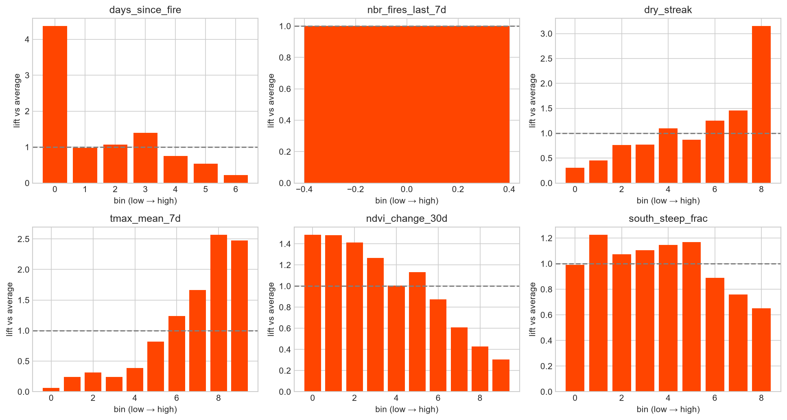

**Known gaps:** 3 coastal sliver cells have no NDVI (left as NaN for LightGBM, filled for the baseline). Weather anomalies are missing for the first ~year (6.3% of rows), since no past normal exists yet.

### Baseline model + MLflow (Day 8)

Script: [`src/train_baseline.py`](src/train_baseline.py) · Results: [`reports/baseline_results.csv`](reports/baseline_results.csv)

**Split by time, never at random** (a random split would let the model train on days after the ones it is tested on):

| Split | Period | Rows | Fires | Fire rate |
|---|---|---|---|---|
| Train | 2012 – 2021 | 1.77M | 3,343 | 0.19% |
| Validation | 2022 – 2023 | 356k | 593 | 0.17% |
| Test | 2024 – Oct 2026 | 504k | 1,377 | 0.27% |

The test period is held back and scored only once per final model. It includes the record 2024 season, so it is the harder period.

**Metrics for a 0.2% positive rate** (accuracy is meaningless: "never fire" scores 99.8%):
- **PR-AUC** (average precision): the main metric. A random guess scores about the fire rate, so **lift** = PR-AUC ÷ fire rate is reported too
- **ROC-AUC**: overall ranking quality
- **Recall@top5%**: share of tomorrow's fires that fall inside the 5% riskiest cells of each day (~24 of 488 cells), the number a fire team would act on

The scorer was checked on random scores first (PR-AUC ≈ fire rate, ROC-AUC ≈ 0.5, recall ≈ 5%).

**Validation results**

| Model | PR-AUC | Lift | ROC-AUC | Recall@top5% |
|---|---|---|---|---|
| Climatology (cell's past fire rate) | 0.0056 | 3.4× | 0.79 | 21% |
| Persistence (fires in the last 7 days) | 0.0080 | 4.8× | 0.57 | 19% |
| **Logistic regression** | **0.0189** | **11.4×** | **0.85** | **30%** |

- The two rule-based baselines need no training and set the bar: each catches a different part of the signal ("where it burns" vs "what burned recently").
- Logistic regression combines both with vegetation, terrain and calendar features: **2.5× the PR-AUC of the best rule**, and the daily top 5% of cells holds **30%** of next-day fires.
- Its riskiest predictions reach ~10–20% precision, against a 0.17% random rate.

**Pipeline:** median imputer with missing-value flags → standard scaler → logistic regression (`class_weight="balanced"`), built as one scikit-learn pipeline so training and prediction always run the same steps. Training takes ~30 s on 1.77M rows.

**Experiment tracking (MLflow):** every run logs its parameters, validation metrics, a precision-recall curve and, for real models, the fitted pipeline with its input signature (all inputs declared as floats, so missing values never break the API later). Runs are stored locally in `mlflow.db` + `mlruns/` (kept out of Git). View them with:

```bash
mlflow ui --backend-store-uri sqlite:///mlflow.db --port 5000
```

**Rerun with full weather (Day 9):** once the weather download finished, all baselines were retrained. Logistic regression barely moved (lift 11.9× → 11.4×, within noise). Fire weather works through thresholds and combinations (hot *and* dry *and* windy), which a linear model can't capture. That's the motivation for tree models.

### LightGBM (Day 9)

Script: [`src/train_lgbm.py`](src/train_lgbm.py) · Results: [`reports/model_results.csv`](reports/model_results.csv)

Same split, same rows and the same scoring function as Day 8 (imported, not copied), so the comparison is exact.

**Setup**
- No imputer or scaler: trees route missing values themselves and ignore feature scale
- `month` and `day_of_week` as fixed-category features (same codes in every split)
- Imbalance: `scale_pos_weight = √529 ≈ 23`. The full ratio (529) makes trees bend around the 3,343 training fires; it also inflates probabilities, so scores are used for **ranking**, not as real chances
- Early stopping on validation PR-AUC (patience 100 trees)

**First attempt overfit:** with default-style settings (31 leaves, 200 rows per leaf, learning rate 0.05), validation PR-AUC peaked at **tree 31** (0.0104) and then fell. Stronger regularization fixed it: 15 leaves, ≥ 1,000 rows per leaf, half the features per tree, L2 = 10, learning rate 0.02 → best at **tree 199**, PR-AUC **0.0152**.

**Validation results (2022–2023, 593 fires)**

| Model | PR-AUC | Lift | ROC-AUC | Recall@top5% |
|---|---|---|---|---|
| Climatology | 0.0056 | 3.4× | 0.79 | 21.1% |
| Persistence | 0.0080 | 4.8× | 0.57 | 19.1% |
| Logistic regression | **0.0189** | **11.4×** | 0.85 | 29.5% |
| **LightGBM** | 0.0152 | 9.1× | **0.86** | 29.0% |

- **Level with logistic regression, read honestly:** logreg is sharper at the very top of its ranking (higher PR-AUC), LightGBM ranks slightly better overall (ROC-AUC), and both catch ~29–30% of next-day fires in each day's top 5% of cells.

**Ablation: does weighting or bagging help?**

| Run | `scale_pos_weight` | Bagging (80% rows) | PR-AUC | ROC-AUC | Recall@top5% |
|---|---|---|---|---|---|
| A | 1 (off) | off | 0.0158 | 0.866 | 31.9% |
| B | √529 ≈ 23 | off | 0.0159 | 0.864 | 30.4% |
| D (final) | √529 ≈ 23 | on | 0.0152 | 0.859 | 29.0% |

- Neither setting helps: the plainest run scored best on recall, though the gaps (~17 fires of 593) are near the noise level of one validation window.
- Lesson from the process: two runs were invalid because pasted settings ended up inside `#` comments. Each run is checked against its logged parameters in MLflow before the scores are trusted.
- Next: Day 10's multi-fold time validation measures the noise; Day 11's Optuna search covers `scale_pos_weight` (including 1) and the bagging settings.

**What the trees rely on (gain):** `days_since_fire` and `cell_fire_rate` (where fires happen) far ahead, then `tmax` and `tmax_mean_7d` (when). Weather is the trees' #3–4 driver, while it added nothing to logistic regression. The top two features drift over time (noisy early years, "never burned" mostly at the start), so Day 10 checks how stable they are across periods.

**MLflow:** logged to the same `wildfire-baseline` experiment, tagged `stage=lightgbm`, with all parameters, best iteration, metrics, PR curve, a feature-importance chart and the model.

### Spatial + time validation (Day 10)

Scripts: [`src/validate.py`](src/validate.py) · [`src/compare_validation.py`](src/compare_validation.py) · [`src/save_folds.py`](src/save_folds.py) · Results: [`reports/validation_summary.csv`](reports/validation_summary.csv)

One validation window is one roll of the dice, and wildfire rows are not independent: a cell today looks like the same cell tomorrow, and neighbouring cells share the same weather. Day 10 measures how much the score depends on **how** the data is split.

**1. Why a random split lies.** The same LightGBM (Day 9 settings, a fixed 500 trees, no early stopping on the test part) trained twice:

| Split | PR-AUC | Lift | ROC-AUC |
|---|---|---|---|
| Random 80/20 rows (all years mixed) | 0.0313 | 15.7× | 0.876 |
| Time: train < 2022, test 2022–23 | 0.0147 | 8.8× | 0.859 |

The random split **doubles PR-AUC** only because test rows have near-copies in training (the same cell a day earlier, the neighbour on the same day). Recall@top5% isn't compared here: a random split leaves only ~20% of each day's cells in the test set, so its daily ranking isn't comparable.

**2. Three honest schemes**, all on 2012–2023. 2024+ is the locked final test set and never touched:

- **Time (walk-forward):** 6 folds; train on every year before, test on one year (2018 … 2023). A **1-day gap** drops Dec 31 from training, since its label is the first test day.
- **Spatial:** Lebanon cut into **32 blocks of 25 × 25 km** (~15 cells each), randomly spread over 5 folds. Whole blocks are held out, because single held-out cells would leak through their neighbours.
- **Space + time (strict):** for each test year, 5 models, each trained only on **earlier years in other regions**. Their predictions are stitched back into one full year, so every cell is scored by a model that never saw its region or its future (30 trainings).

**3. Results (mean ± std across folds)**

| Scheme | PR-AUC | Lift | ROC-AUC | Recall@top5% | Precision@top5% |
|---|---|---|---|---|---|
| Time | 0.019 ± 0.009 | 9.5 ± 3.5× | 0.852 ± 0.018 | 23.3 ± 6.3% | 0.92% |
| Spatial | 0.021 ± 0.011 | 12.9 ± 7.2× | 0.852 ± 0.039 | 23.6 ± 7.7%* | 0.83% |
| **Space + time** | **0.015 ± 0.006** | **7.9 ± 2.1×** | **0.837 ± 0.021** | **21.0 ± 4.6%** | **0.82%** |

\*Spatial folds rank only ~100 cells per day, not 488, so their recall isn't directly comparable.


**What it shows**
- **Year-to-year noise is large:** PR-AUC ranges from 0.006 (2018) to 0.028 (2023). Day 9's single 2022–23 window couldn't separate models that differ by less than this.
- **More history helps:** the 2018 fold (6 training years) is the weakest; the 2023 fold (11 years) catches **35%** of fires in the top 5%. That's an argument for retraining as new years arrive (Day 15).
- **Unseen regions cost ~2 recall points:** part of what the model learns is local (e.g. regular agricultural burning in specific places). The regions holding the most fires are the hardest to predict when held out (ROC-AUC 0.80–0.83).
- **Headline number:** in regions and years the model never trained on, **21% of next-day fires fall in the 5% of cells flagged each day**, about 8× better than random.
- **Alert precision:** ~0.9% of flagged cells burn the next day, **~5× the average cell**. With ~24 flagged cells per day, about one burns every 4–5 days.

**4. The probabilities are off (calibration).** Brier skill score ≈ **−2** in every scheme: the probabilities are worse than always guessing the average fire rate, even though the **ranking** is good. That's the side effect of `scale_pos_weight ≈ 23`, which pushes every score up. The model is fine for "which cells are riskiest", but its raw scores must not be shown as "% chance of fire". They will be calibrated, or shown as risk levels (top 1% / 5% / 20%), before the API and map.

**5. Decision: the official validation setup** ([`reports/validation_config.json`](reports/validation_config.json))
- **Tune on the time folds** (6 trainings per Optuna trial, ~2 min) and **report on space + time** (30 trainings, ~7 min). Tuning on the strict scheme would cost ~5 hours for 40 trials.
- Cell → spatial-fold assignments are saved to `data/processed/cell_folds.parquet`, so Day 11 uses exactly the same regions.
- 2024+ stays locked until the final test.

**MLflow:** experiment `wildfire-validation`, one parent run per scheme (mean and std of every metric + the fold table) and one nested child run per fold.

**Follow-ups (done on Day 11):** the south vs rest and security-event vs normal breakdown is part of the final test. The NDVI gap (Jun–Nov 2025) lies entirely inside the locked 2024+ test period and every feature looks only at the past, so filling it doesn't change any validation or tuning result; only the final test was re-scored.


### Optuna tuning + final test (Day 11)

Scripts: [`src/tune.py`](src/tune.py) · [`src/tuning_report.py`](src/tuning_report.py) · [`src/best_params.py`](src/best_params.py) · [`src/confirm_tuned.py`](src/confirm_tuned.py) · [`src/final_test.py`](src/final_test.py) · [`src/train_final.py`](src/train_final.py) · Settings: [`configs/best_params.json`](configs/best_params.json)

**Search setup**
- **Scored on Day 10's 6 walk-forward time folds** (test years 2018–2023), mean PR-AUC as the objective; recall@top5% and per-fold scores stored on every trial. 2024+ never touched.
- **10 settings searched** with TPE: learning rate, tree size, rows per leaf, feature/row sampling, L1/L2 penalties, minimum split gain, number of trees, and `weight_power`: fire weight = (non-fires / fires) ^ power, so 0 = no weighting and 0.5 = Day 9's square root. One number covers the whole Day 9 weighting ablation.
- **No early stopping on the test year** (that would leak); the tree count is tuned instead.
- **Day 9 settings enqueued as trial 0**, reproducing Day 10's time-scheme score exactly (0.0187), so every trial is compared to a verified baseline.
- **Median pruning** after 3 of 6 folds, **resumable SQLite study** (`optuna.db`), every trial logged to MLflow (`wildfire-tuning`) through a sync that never logs a trial twice.
- **70 trials** (53 complete, 17 pruned). The search was extended from 50 to 70 because the best trial at 50 was the last one; the extra 20 improved it by only 1%, so it had levelled off.

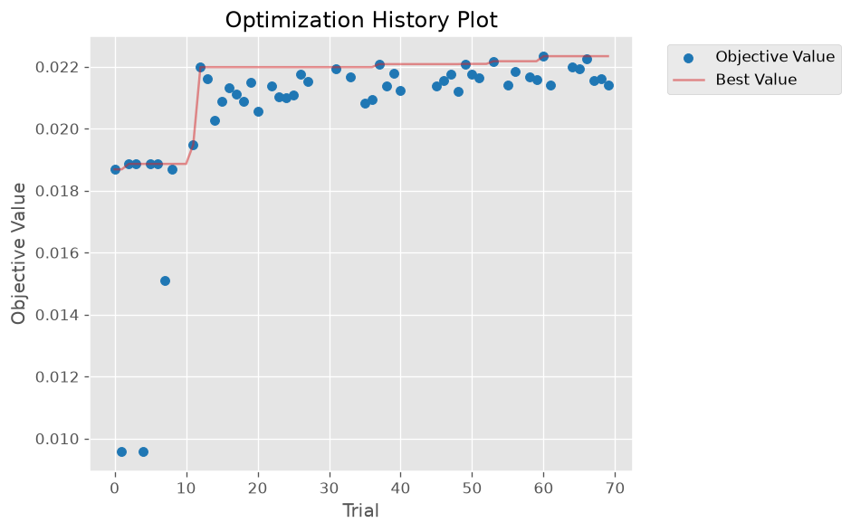
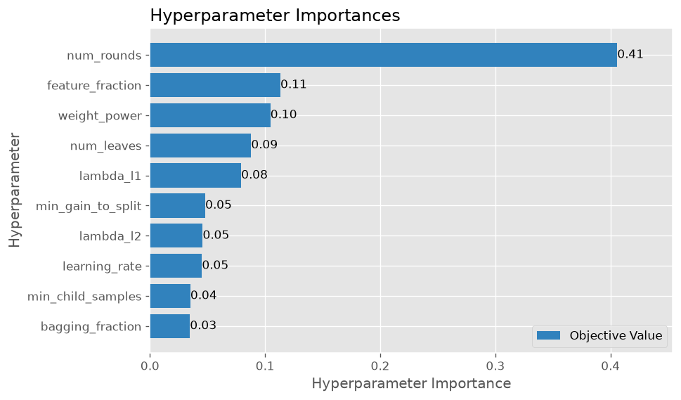

**What won:** the top 10 trials agree: almost **no fire weighting** (power 0.007–0.11), **heavy regularization** (3,100–4,800 rows per leaf), small learning rate (0.011–0.017) and only 300–450 trees. The model does best when forced to learn broad patterns. The best `min_child_samples` (4,824) sits near the top of the range (5,000), but scores are flat across 3,100–4,800, so a wider search would add little.

**Did tuning really help?** Three checks, each harder than the last:

| Check | Day 9 settings | Tuned | Verdict |
|---|---|---|---|
| Time folds (used for tuning) | 23.3% recall@top5% | 25.9% | wins 6/6 years (PR-AUC 5/6) |
| Space + time (unseen regions + future) | 21.0% | **24.5%** | **wins 6/6 years** |
| **Final test 2024+ (opened once)** | 28.9% | **30.7%** | ~24 more fires caught of 1,377 |

**Final test (train 2012–2023, test Jan 2024 – Oct 2026)**

| Model | PR-AUC | Lift | ROC-AUC | Recall@top5% | Precision@top5% | Brier skill |
|---|---|---|---|---|---|---|
| Day 9 settings | **0.053** | **19.4×** | 0.873 | 28.9% | 1.61% | −1.85 |
| **Tuned (official)** | 0.049 | 17.9× | **0.878** | **30.7%** | **1.70%** | **+0.02** |

- **Tuning improved the part of the ranking the map uses** (the daily top 5%), in 7 of 8 groups below.
- **PR-AUC fell 8%**, concentrated in 2024 and 2026, when fires came in persistent bursts. Day 9's fire weighting pushes cells that are already burning to the extreme top, which PR-AUC rewards. The tuned model was chosen *before* the test set was opened, on the product's metric, so it stays the official model. Picking a model by its test score would turn the test into another validation set.
- **Calibration fixed:** dropping the fire weighting moved Brier skill from −1.85 to slightly positive, so the raw scores are no longer inflated probabilities.
- **Test scores are higher than cross-validation** because the model trained on 12 years and the 2024 bursts are easier to predict.

**Breakdown** (recall = share of a group's fires inside Lebanon's top 5% of cells each day, one national ranking):

| Group | Fires | Day 9 | Tuned |
|---|---|---|---|
| South (below 33.35°N, 64 cells) | 579 | 36.8% | **39.7%** |
| Rest of Lebanon | 798 | 23.2% | **24.1%** |
| Security-event period (Jan 1 – Nov 27, 2024) | 685 | 28.5% | **31.2%** |
| Outside that period | 692 | 29.3% | **30.1%** |
| 2024 | 701 | 29.0% | **31.2%** |
| 2025 | 354 | 22.6% | **25.1%** |
| 2026 (to Oct 28) | 322 | **35.7%** | 35.4% |

- **The south is easier:** its fires come in bursts that the recent-fire features catch. Scattered, weather-driven fires in the rest of Lebanon are harder.
- **The score isn't carried by the 2024 events:** recall is about the same inside and outside that period.
- **2025 is the weakest year, and not because of missing data:** it stays the weakest with the real NDVI filled in (see below).

**NDVI gap fill (AppEEARS):** the final test was first run with forward-filled NDVI for Jun–Nov 2025. After the missing composites were filled from NASA AppEEARS, it was re-scored with the **same frozen settings** (nothing re-tuned):

| | Before fill (forward-filled) | After fill (real NDVI) |
|---|---|---|
| Tuned, all 2024+ | 30.8% recall@top5% | 30.7% |
| Tuned, 2025 | 25.7% | 25.1% |
| Day 9 settings, 2025 | 21.5% | 22.6% |
| 2024 (both models) | unchanged | unchanged |

- **The fill barely moved the scores** (±1 point in 2025, ~2 fires overall). The NDVI-age feature had already told the model when vegetation data was stale, so forward-fill was a safe stopgap.
- **2024 is unchanged,** as expected: every feature looks only at the past, so 2025 data can't change earlier rows. For the same reason the Day 10 validation and the whole Optuna search (2012–2023) are unaffected.
- **Why it still matters:** the daily pipeline and live map (Days 15–16) must never run on months-old vegetation data.

**Production model:** retrained with the tuned settings on all labeled data with the filled NDVI (Jan 2012 – Oct 2026, 2.6M rows, 5,313 fires), saved as `models/lgbm_tuned.txt` + `models/model_meta.json` (feature order, categorical columns, training range, test scores), reload-checked, and registered in the MLflow Model Registry as **`lebanon-wildfire-lgbm` v2** (v1 was the same recipe on forward-filled NDVI).


### SHAP explainability (Day 12)

Scripts: [`src/explain.py`](src/explain.py) · [`src/shap_plots.py`](src/shap_plots.py) · Ranking: [`reports/shap_importance.csv`](reports/shap_importance.csv)

**Setup**
- **Model explained:** the production model (`models/lgbm_tuned.txt`, registry v2), the one the API and map will use.
- **Rows explained:** 4,377 cell-days from Jan 2024 – Oct 2026: all 1,377 fire days plus 3,000 random no-fire days, so both outcomes are well covered.
- **Exact values:** `TreeExplainer` on the LightGBM model. Base value + all feature pushes rebuilds every raw score (max error 2e-14).
- **Categorical fix:** `month` and `day_of_week` were trained as pandas categories, so `prepare_X()` restores the exact training categories before every prediction. The API reuses it.
- Plots, the importance table, top-10 SHAP metrics and tags are logged to the model's MLflow run (artifacts → `shap/`).

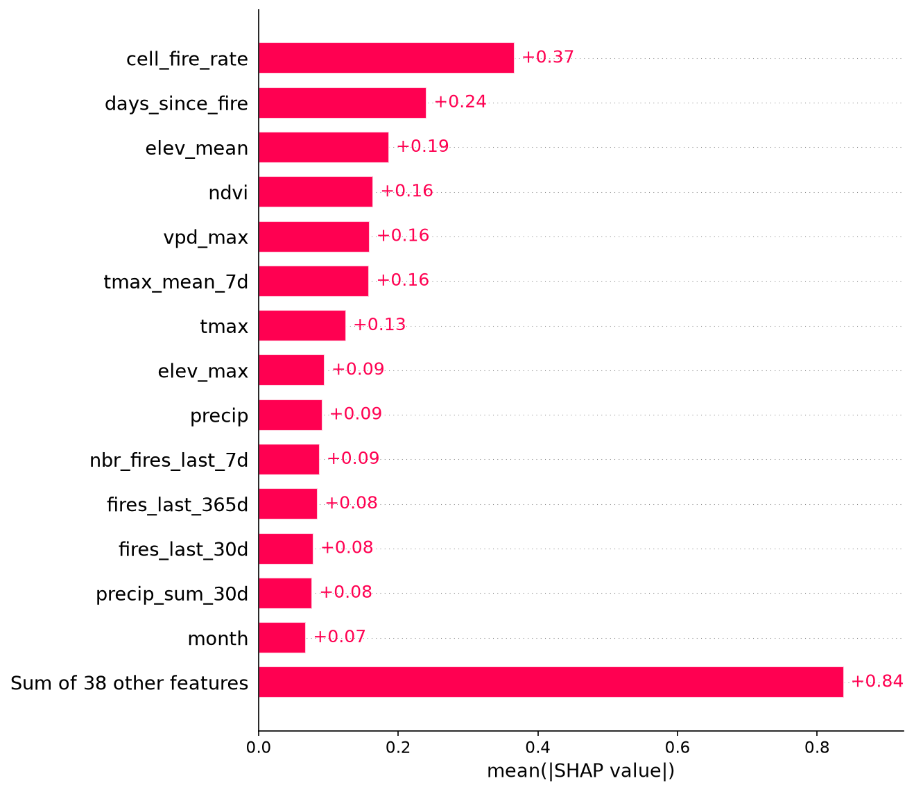
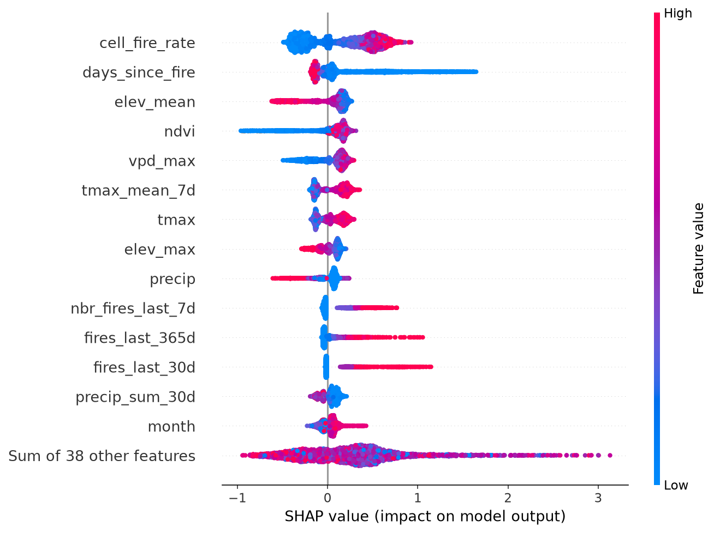

**What drives next-day fire risk**
- **Fire history matters most:** cells that burn often (`cell_fire_rate`) or burned recently (`days_since_fire`) stay risky.
- **Terrain and fuel come next:** lower and middle elevations and greener cells (more fuel) burn more.
- **Heat and dry air raise risk** (max temperature, 7-day heat, VPD, days without rain); **moisture lowers it** (humidity, recent rain).

**Sanity checks**

Spearman correlation between each feature's value and its SHAP push (+ = higher value raises risk):

| Feature | Correlation | Expected? |
|---|---|---|
| `tmax` / `tmax_mean_7d` | +0.90 / +0.87 | ✅ hotter = riskier |
| `vpd_max` | +0.84 | ✅ drier air = riskier |
| `dry_streak` | +0.80 | ✅ longer dry spell = riskier |
| `rh_min` | −0.86 | ✅ humid = safer |
| `precip` / `precip_sum_30d` | −0.75 / −0.71 | ✅ rain = safer |
| `cell_fire_rate` | +0.94 | ✅ fire-prone places = riskier |
| `days_since_fire` | −0.96 | ✅ recently burned = riskier |
| `ndvi` | +0.32 | ✅ more fuel = riskier (Lebanon's fires are in dry-summer forest and scrub) |
| `elev_mean` | −0.86 | ✅ cold high mountains burn less |
| `wind_max` | −0.23 | ⚠️ see below |

- **No leakage in the top feature:** `cell_fire_rate` was rebuilt from scratch as an expanding mean (past days and today only) for 5 random cells and matched the saved feature (max difference 2e-10).
- **Day 7 follow-up:** `south_steep_frac` ranks outside the top 15. With elevation in the model, the steep-slope signal adds little: the steepest cells are high, rocky and low on fuel, and `elev_mean` (#3) carries that effect.
- **Wind surprise:** high wind slightly *lowers* predicted risk. In Lebanon the windiest days are mostly rainy winter storms; the hot, dry eastern-wind fire days are a small share of windy days. Wind's effect is small (not in the top 15). Future work: a wind-direction feature, or wind measured only on dry days.

**How each feature pushes risk** (x = feature value, y = SHAP push, above 0 raises risk)

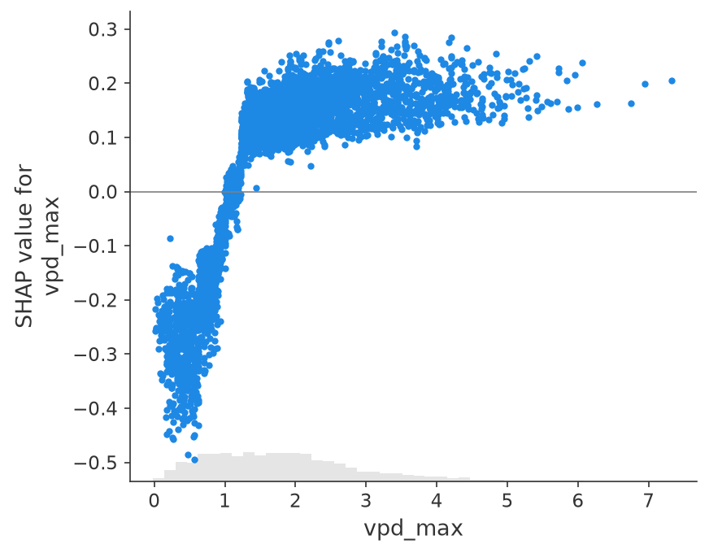
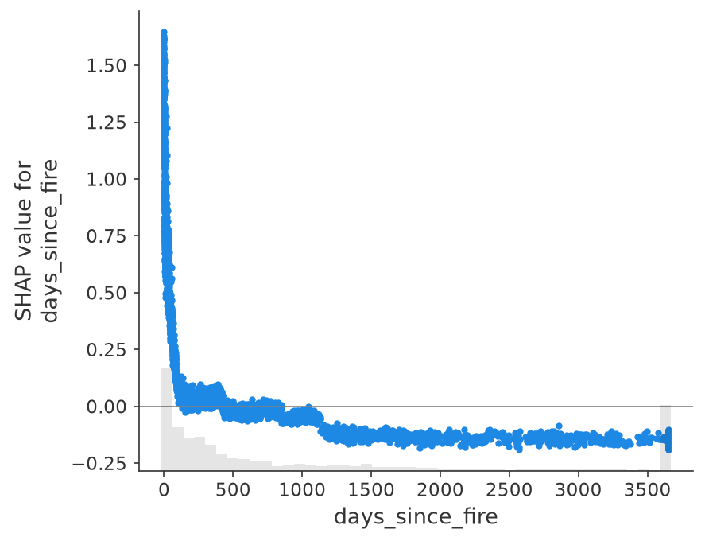

**One prediction, explained:** the riskiest real fire day in the sample (cell 10, 24 Oct 2024, 68% risk), from the base value to the final score:

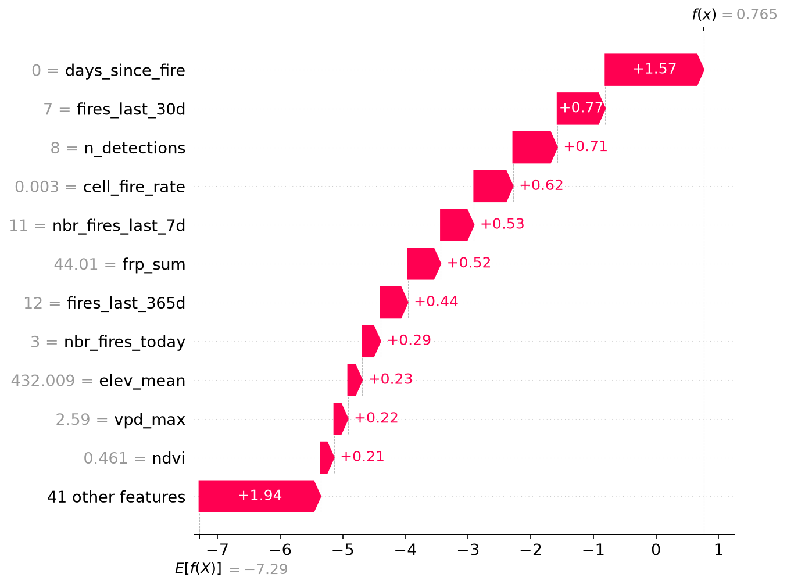

**Top-3 reasons for every cell:** `top_reasons()` in `src/explain.py` returns each cell's risk plus its 3 strongest drivers in plain English (for example *"days since the last fire here = 3 → raises risk"*). It uses LightGBM's built-in `pred_contrib=True`, which matches SHAP exactly (max difference 0.0), so the API doesn't need the `shap` package.

**Notes**
- **SHAP explains the model, not its accuracy.** The production model was trained on all years, including 2024–2026, so these rows are not unseen data for it. The honest scores are the Day 11 final test (model trained only on 2012–2023).
- **Raw risks look small** (fires happened on cell-days scored 0.2–0.7%) because fires are rare: the base risk is ~0.07%, so 0.7% is 10× normal. The map (Day 16) will show risk classes relative to normal, not raw percentages.

### FastAPI service (Day 13)

The tuned model is now a web service: send it features, get back next-day risk, a risk level and the reasons behind it. It loads the model and serving data **once at startup** and scores the whole country (488 cells + GeoJSON) in **~13 ms**.

**Endpoints**

| Method | Path | What it returns |
|--------|------|-----------------|
| GET | `/health` | Model file, training end date, feature count, risk cutoffs |
| POST | `/predict` | Risk + level for one cell-day (`?reasons=true` adds the top 3 SHAP reasons) |
| POST | `/predict/batch` | The same for up to 5,000 rows in one call (used by the daily pipeline) |
| GET | `/risk/latest` | Every cell on the newest day as a GeoJSON map, plus counts per level |
| GET | `/risk/{date}` | The same map for any day in the serving window (last 400 days) |
| GET | `/explain/{cell_id}` | Why one cell has its risk: top `k` reasons in plain English (`?day=`, `?k=1..10`) |

Interactive docs (Swagger) are built automatically at `/docs`.

**Risk levels instead of raw percentages.** Fires are rare, so raw probabilities are all small and hard to read. Each cell-day is ranked against 2024–2026 instead (`src/risk_levels.py`, saved to `models/risk_levels.json`):

| Level | Share of cell-days | Probability cutoff | Next-day fire rate | vs. low |
|-------|-------------------|--------------------|--------------------|---------|
| low | 80% | below 0.32% | 0.05% | 1× |
| moderate | 15% | 0.32% | 0.58% | ~12× |
| high | 4% | 1.03% | 1.7% | ~34× |
| extreme | 1% | 2.66% | 7.6% | ~150× |

**Example:** why was cell 464 (north Lebanon) "extreme" on 29 Oct 2026, in the quiet season?

```bash
curl "http://127.0.0.1:8000/explain/464?k=3"
```

```json
{
  "cell_id": 464, "date": "2026-10-29", "forecast_for": "2026-10-30",
  "risk": 0.068063, "level": "extreme",
  "reasons": [
    {"label": "days since the last fire here", "value": 0.0, "impact": 1.394, "direction": "raises risk"},
    {"label": "fire days here this month", "value": 3.0, "impact": 0.747, "direction": "raises risk"},
    {"label": "how often this area burns", "value": 0.0039, "impact": 0.54, "direction": "raises risk"}
  ]
}
```

It was burning that day. Fires often continue or re-ignite the next day, and the model has learned that persistence.

**Design choices**
- **Strict inputs.** LightGBM matches columns by position, so the API rebuilds them in the model's own order and rejects missing or unknown feature names (typos) with a clear 422, row by row.
- **Two layers of validation.** Pydantic checks the shape and types; the predictor checks the names against `model_meta.json`.
- **Reasons without the `shap` package.** LightGBM's `pred_contrib=True` gives the same values as SHAP (checked on Day 12), which keeps the API light.
- **Serving files, separate from training data.** `src/export_serving.py` writes `data/serving/recent_features.parquet` (last 400 days, no label: 6 MB instead of the 113 MB training table) and `grid.geojson` (cells in lat/lon). The API doesn't need geopandas.
- **Safe errors and logging.** Every request is logged with status and time (4xx as warnings). An unexpected crash returns a generic 500 to the caller; the full traceback goes only to the server log. Every answer carries an `X-Process-Time-ms` header.
- **One prediction, four routes, one answer.** `/predict`, `/predict/batch`, `/risk` and `/explain` are tested to return the identical risk for the same cell-day.

**Tests:** 24 pass (`python -m pytest -q`): happy paths, every error code (404 / 422 / 500), route consistency, level boundaries, logging, and a check that all 52 features have plain-English labels.

**Run it**

```powershell
python src\risk_levels.py
python src\export_serving.py
uvicorn src.api.main:app --reload
```

Then open http://127.0.0.1:8000/docs, or send real rows with `python src\call_api.py predict` / `python src\call_api.py batch`.

**Notes**
- **The level fire rates are optimistic.** They were measured with the production model on 2024–2026, which it was trained on. The honest, unseen-data performance is the Day 11 final test. The levels are a readable ranking, not a promise of exact rates.
- **"Extreme" often means "already burning".** Most extreme cells have a fire today; "high" and "moderate" cells are where the model reads risk from weather, vegetation and history. The map should make that difference clear.
- **The API serves features prepared offline.** Until the daily pipeline (Day 15) appends a new day each morning, the newest map is the last day in the feature table.

### Docker (Day 14)

The API now ships as a Docker image, so it runs the same way on any machine: same Python, same library versions, same model. One command starts it, and one script checks it end to end.

```powershell
docker compose up -d --build        # build the image and start the API at http://localhost:8000
docker compose ps                   # wait for STATUS "healthy"
python scripts\smoke_test.py        # 11 end-to-end checks against the running container
docker compose down                 # stop and remove the container
```

Without Compose:

```powershell
docker build -t lebanon-wildfire-api:1.0.0 -t lebanon-wildfire-api:latest .
docker run -d --name wildfire-api -p 8000:8000 lebanon-wildfire-api:1.0.0
```

**Measured on the running container**

| | |
|---|---|
| Build context | 11 files, 7 MB (allowlist `.dockerignore`) |
| Image size | 878 MB on disk, 206 MB compressed |
| Of which: Python packages | 530 MB (LightGBM, pandas, pyarrow, scipy, numpy) |
| Of which: model + data + code | 7.3 MB |
| Memory at runtime | ~340 MB, tested under a 512 MB cap |
| Rebuild after a code change | seconds (dependency layers cached) |
| Shutdown | clean, 0.8 s |
| Smoke test | 11/11 checks pass |

**Design choices**
- **Small runtime package list.** `requirements-api.txt` has only what the API imports, pinned to the exact versions the model was trained and tested with (LightGBM 4.7.0, pandas 3.1.0, numpy 2.5.4). Training tools (geopandas, MLflow, Optuna, SHAP, Jupyter) stay out of the image.
- **Allowlist `.dockerignore`.** It ignores everything, then lets back in only `src/api/`, `models/`, `data/serving/` and `requirements-api.txt`. New data folders can never leak into the image by accident.
- **Layer order for fast rebuilds.** System library and pip install come first; code, model and data last. Changing `main.py` rebuilds in seconds instead of reinstalling pandas.
- **`python:3.12-slim` + `libgomp1`.** Same Python as the venv; `libgomp1` is the OpenMP library LightGBM needs at runtime.
- **Non-root user.** The API runs as `appuser`; the code and model files belong to root and are read-only for it.
- **Built-in health check.** Docker calls `/health` every 30 s and marks the container healthy or unhealthy; Compose restarts it after a crash (`restart: unless-stopped`).
- **Clean shutdown.** `exec` makes uvicorn process 1, so `docker stop` reaches it directly and the lifespan shutdown runs.
- **Ready for hosting.** The port comes from a `PORT` variable, uvicorn's duplicate access log is off (the app logs every request itself), and logs use UTC.
- **Tested under a free-plan memory limit.** Compose caps the container at 512 MB, the size of many free hosting plans, and the whole smoke test (including a 488-cell batch) passes inside it.

**Smoke test** (`scripts/smoke_test.py`, works against any URL: `python scripts\smoke_test.py https://...`):
- `/health` is ok and the container's model has the same 52 features as the local model file
- `/risk/latest` returns all 488 cells, the level counts add up, and the timing header is present
- `/explain/464` returns 3 reasons, and `/predict` on the same raw features gives the identical risk
- `/predict/batch` scores all 488 cells in one call
- a wrong cell or date gives 404, a misspelled feature gives 422

**Notes**
- **The model and serving data are not in Git** (`models/*` and `data/serving/` are ignored). The image is built from the local project folder, which has them. Deploying from GitHub (Day 17) needs a way to deliver these files.
- **First builds are slow on a slow connection.** The base image and Python packages are about 200 MB to download once; `PIP_DEFAULT_TIMEOUT=120` and `PIP_RETRIES=10` in the Dockerfile stop pip from giving up too early. After that, everything is cached.

## Scripts

| Script | What it does |
|--------|--------------|
| `src/check_setup.py` | Checks that the environment and packages work |
| `src/fetch_firms.py` | Downloads raw FIRMS fire detections (needs `FIRMS_MAP_KEY` in `.env`) |
| `src/clean_firms.py` | Cleans detections and saves `data/raw/firms_lebanon.parquet` |
| `src/check_firms.py` | Prints summary checks on the cleaned fire data |
| `src/download_boundary.py` | Downloads Lebanon's border (geoBoundaries) |
| `src/grid.py` | Builds the 5 km grid, land fractions and cell points |
| `src/join_fires.py` | Assigns fires to cells and flags persistent hotspots |
| `src/check_inputs.py` | Checks the grid points and fire date range before the weather download |
| `src/weather.py` | Builds the 0.1° weather grid and downloads all weather batches (run once per day until complete) |
| `src/combine_weather.py` | Merges the batches into one weather table per cell per day |
| `src/check_weather.py` | Monthly climate summary + coast vs inland check chart |
| `src/ndvi.py` | Downloads MODIS NDVI for every date and saves per-cell means (parallel, resumable) |
| `src/ndvi_appeears.py` | Turns the NASA AppEEARS GeoTIFFs for the Jun–Nov 2025 catalog gap into per-cell NDVI files, the same format as `ndvi.py` |
| `src/combine_ndvi.py` | Combines the NDVI files, adds `available_date` and runs date/gap checks |
| `src/terrain.py` | Downloads the 90 m DEM, computes slope/aspect and saves per-cell terrain features |
| `src/check_day5.py` | Maps of NDVI, elevation and steep south-facing share + NDVI seasonal cycle |
| `src/check_data.py` | Status report for every dataset: rows, columns, date range, missing values, download progress |
| `src/features.py` | Builds the leakage-safe feature table (`features.parquet`) and the feature list (`feature_columns.json`) |
| `src/train_baseline.py` | Time split, naive baselines, logistic regression, MLflow logging; saves `reports/baseline_results.csv` |
| `src/train_lgbm.py` | LightGBM with early stopping, same split + metrics as the baseline, MLflow logging; saves `reports/model_results.csv` |
| `src/validate.py` | Random-split leak demo + time, spatial and space-time validation folds, MLflow logging; `python src\validate.py all` |
| `src/compare_validation.py` | Mean ± std table and per-fold PR-AUC chart for the three schemes |
| `src/save_folds.py` | Saves the official cell → fold table and `validation_config.json` for Day 11 |
| `src/tune.py` | Optuna search on the time folds: pruning, resumable SQLite study, MLflow logging; `python src\tune.py 70` |
| `src/tuning_report.py` | Optimization-history and importance charts, top-10 trials, tuned vs Day 9 per year |
| `src/best_params.py` | Saves the winning settings to `configs/best_params.json` and loads them for later scripts |
| `src/confirm_tuned.py` | Reruns the strict space + time scheme with the tuned settings |
| `src/final_test.py` | One-time 2024+ test of both models, south / security-event / per-year breakdown, saves test predictions |
| `src/train_final.py` | Trains the production model on all data, saves it to `models/` and registers it in MLflow |
| `src/explain.py` | SHAP values on a 2024–2026 sample, additivity check, `prepare_X()` category fix and `top_reasons()` helper for the API |
| `src/shap_plots.py` | SHAP importance table, bar, beeswarm, dependence and waterfall plots; logs them to the model's MLflow run |
| `src/risk_levels.py` | Sets the low / moderate / high / extreme cutoffs from 2024–2026 risk quantiles; saves `models/risk_levels.json` |
| `src/export_serving.py` | Writes the small serving files the API reads: `data/serving/recent_features.parquet` and `grid.geojson` |
| `src/api/` | FastAPI service: `schemas.py` (request/response shapes), `predictor.py` (model, levels, reasons), `store.py` (serving data), `main.py` (endpoints, logging, errors) |
| `src/call_api.py` | Sends real feature rows to the running API: `python src\call_api.py predict` or `batch [YYYY-MM-DD]` |
| `Dockerfile` | Builds the API image: Python 3.12-slim, `libgomp1`, pinned packages, non-root user, health check, `PORT` variable |
| `.dockerignore` | Allowlist: only `src/api/`, `models/`, `data/serving/` and `requirements-api.txt` reach the build |
| `requirements-api.txt` | Runtime packages for the container only, pinned to the training versions |
| `docker-compose.yml` | Runs the API service with port 8000, auto-restart and a 512 MB memory cap |
| `scripts/smoke_test.py` | 11 end-to-end checks against a running API, local or deployed: `python scripts\smoke_test.py [URL]` |
| `tests/test_features.py` | pytest checks: future-leakage test, label correctness, completeness, NDVI timing, feature list |
| `tests/test_api.py` | API tests with FastAPI's TestClient: every endpoint, error codes, route consistency, level boundaries |
| `tests/test_labels.py` | Every model feature has a plain-English label, and no label is stale |
| `tests/test_errors.py` | Unexpected errors give a clean 500 without leaking details; requests are logged and timed |
| `notebooks/06_eda.ipynb` | Exploratory data analysis: target, hotspots, timing, location, conflict shift, terrain, NDVI, weather |
| `notebooks/07_features_check.ipynb` | Missing values per feature and feature lift charts |

## Pipeline Order

1. `python src\fetch_firms.py`
2. `python src\clean_firms.py`
3. `python src\download_boundary.py`
4. `python src\grid.py`
5. `python src\join_fires.py`
6. `python src\weather.py` *(repeat daily until "All batches downloaded.")*
7. `python src\combine_weather.py`
8. `python src\check_weather.py`
9. `python src\ndvi.py` *(rerun until no dates fail)*
10. `python src\ndvi_appeears.py` *(after downloading the AppEEARS files for the 2025 gap)*
11. `python src\combine_ndvi.py`
12. `python src\terrain.py`
13. `python src\check_day5.py`
14. `python src\check_data.py`
15. Open `notebooks\06_eda.ipynb` and **Run All**
16. `python src\features.py`
17. `python -m pytest -v`
18. Open `notebooks\07_features_check.ipynb` and **Run All**
19. `python src\train_baseline.py`
20. `python src\train_lgbm.py`
21. `python src\validate.py all`
22. `python src\compare_validation.py`
23. `python src\save_folds.py`
24. `python src\tune.py 70` *(resumable: rerun the same command after a stop)*
25. `python src\tuning_report.py`
26. `python src\best_params.py`
27. `python src\confirm_tuned.py`
28. `python src\final_test.py`
29. `python src\train_final.py`
30. `python src\explain.py`
31. `python src\shap_plots.py`
32. `python src\risk_levels.py`
33. `python src\export_serving.py`
34. `python -m pytest -q`
35. `uvicorn src.api.main:app --reload` *(then open http://127.0.0.1:8000/docs)*
36. `docker compose up -d --build` *(the same API in a container)*
37. `python scripts\smoke_test.py`