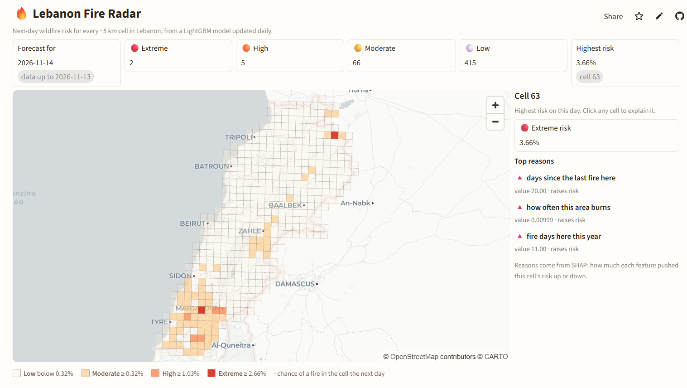
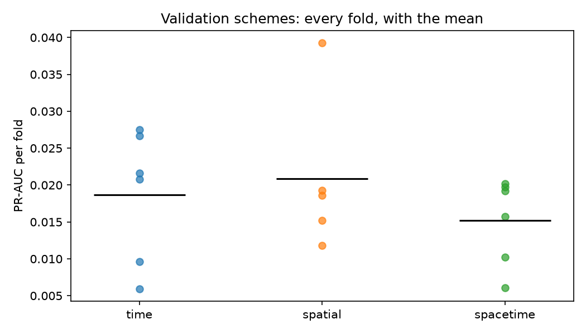
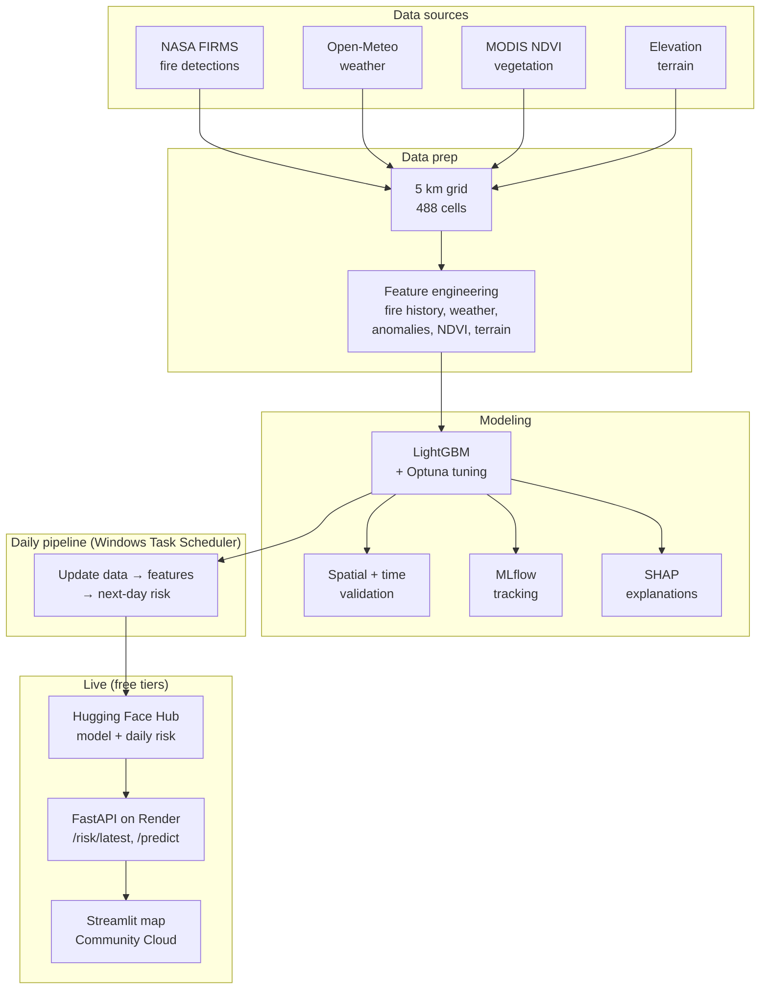
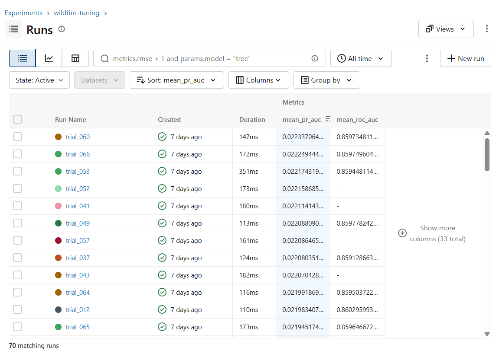
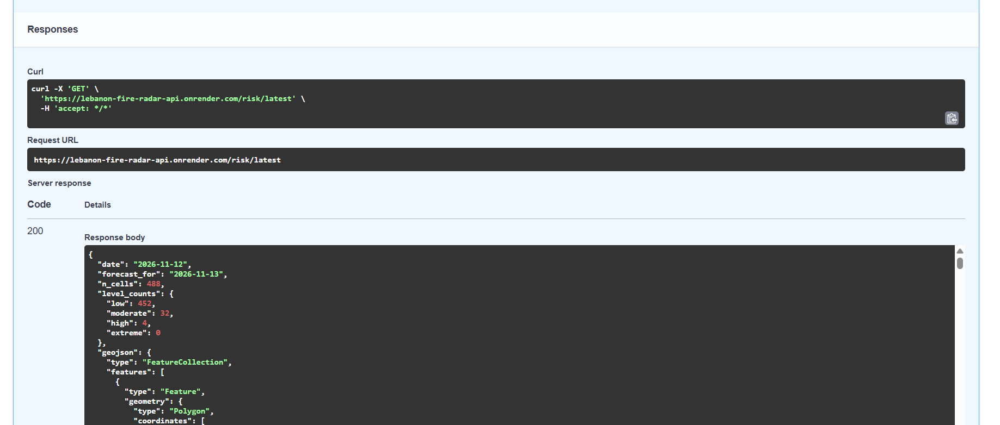

<!-- title and one-line pitch -->
# 🔥 Lebanon Fire Radar

**Next-day wildfire risk for every ~5 km cell in Lebanon, updated daily and shown on a live map.**

<!-- badges: the tech stack at a glance -->


<!-- live links -->
**[🗺️ Live map](https://lebanon-fire-radar.streamlit.app)** · **[⚙️ API docs](https://lebanon-fire-radar-api.onrender.com/docs)** · **[🤗 Model + daily data](https://huggingface.co/datasets/hasan-omeis/lebanon-fire-radar-serving)** · **[📓 Full build log](docs/BUILD_LOG.md)**

> Free hosting: the map and API sleep when nobody visits, so the first load can take about a minute.



<!-- the problem in a few lines -->
## What it does

Every morning, a pipeline downloads new satellite fire detections, weather and vegetation data, rebuilds 52 features for each of Lebanon's **488 grid cells**, and asks a tuned LightGBM model: *how likely is a fire in this cell tomorrow?* Each cell gets a risk level (low → extreme) and the **top 3 reasons** behind it, explained with SHAP. A public API serves the results, and an interactive map shows them.

<!-- headline numbers -->
## Results

Fires are rare: only **0.2–0.3%** of cell-days have a fire the next day, so accuracy is meaningless (always saying "no fire" scores 99.8%). The model is judged by how many real fires land in the cells it flags.

**Final test:** trained on 2012–2023, tested once on **Jan 2024 – Oct 2026** (1,377 fire days the model never saw).

| Metric | Result | What it means |
|---|---|---|
| **Recall @ top 5%** | **30.7%** | Flag the riskiest 5% of cells each day (~24 of 488) and you catch 3 in 10 of tomorrow's fires; random flagging catches 5% |
| **Lift (PR-AUC ÷ fire rate)** | **17.9×** | PR-AUC 0.049 against a 0.27% fire rate |
| **ROC-AUC** | **0.878** | Strong overall ranking of risky vs safe cells |
| **Precision @ top 5%** | **1.70%** | A flagged cell is ~6× more likely to burn than an average cell |
| **Strict test: unseen regions + future years** | **24.5%** recall @ top 5% | Each cell scored by a model that never saw its region or its future |



**Honest validation:** a random train/test split doubles PR-AUC (0.031 vs 0.015) because neighbouring cells and consecutive days leak into training. Every score here uses time-based and spatial splits instead, and 2024+ was locked until the final test.

<!-- system diagram -->
## Architecture



<!-- the pipeline in five steps -->
## How it works

1. **Data:** NASA FIRMS satellite fire detections (13,447 since 2012), Open-Meteo daily weather, MODIS NDVI vegetation (a 2025 gap filled from NASA AppEEARS) and Copernicus terrain, joined on a 5 km grid.
2. **Features:** fire history, burning neighbours, weather and **weather anomalies vs each cell's own normal**, vegetation and its age, terrain and season. Every feature uses only data available that day, and a pytest test proves it.
3. **Model:** LightGBM tuned with Optuna (70 trials, scored on walk-forward time folds), with every run tracked in MLflow.
4. **Explain:** SHAP gives each cell its top 3 reasons in plain English, for example *"days since the last fire here = 3 → raises risk"*.
5. **Serve:** a daily pipeline (Windows Task Scheduler) passes a quality gate, scores all cells and publishes the model and data to the Hugging Face Hub. The FastAPI service on Render reloads the new data, and the Streamlit map reads only from the API.

<!-- what makes it more than a notebook -->
## Engineering highlights

- **Leakage-safe by design:** past-only rolling windows and normals, NDVI joined on its publication date, and a test that injects future fires and checks that earlier rows don't change
- **Calibrated output:** tuning removed the class weighting that inflated probabilities (Brier skill −1.85 → +0.02); the map shows **risk levels**, not misleading raw percentages
- **Quality gate:** a bad data day blocks publishing, so the previous good map stays up
- **Idempotent, self-healing pipeline:** atomic file writes, safe reruns and automatic catch-up after missed days
- **Consistent deploys:** the API downloads one exact Hub commit, so the model and data can never mismatch; live reload swaps files only if both load
- **Production containers:** pinned dependencies, non-root user, health checks, and tested under a 512 MB memory cap
- **Tested:** 40+ pytest tests (features, API, pipeline, map) plus an 11-check smoke test that runs against the live API

<!-- explainability -->
## What drives the risk (SHAP)


- **Fire history comes first:** places that burn often, or burned recently, stay risky
- **Terrain and fuel come next:** low and middle elevations and greener cells burn more
- **Hot, dry air raises risk** (temperature, vapour pressure deficit, dry streaks); **humidity and rain lower it**

<!-- experiment tracking -->
## Experiment tracking



Five MLflow experiments trace the whole path: baseline → validation → tuning (70 Optuna trials) → final test → production model (registered as `lebanon-wildfire-lgbm`).

<!-- the API -->
## API



| Method | Path | Returns |
|---|---|---|
| GET | `/health` | Model info, training end date, risk cutoffs |
| GET | `/risk/latest` | All 488 cells for the newest day as GeoJSON, plus counts per level |
| GET | `/risk/{day}` | The same map for any day in the last 400 |
| GET | `/explain/{cell_id}` | A cell's top reasons in plain English |
| POST | `/predict` | Risk + level for one cell-day (`?reasons=true` adds SHAP reasons) |
| POST | `/predict/batch` | Up to 5,000 rows in one call |

```bash
curl https://lebanon-fire-radar-api.onrender.com/risk/latest
```

<!-- run it yourself -->
## Quick start

```powershell
git clone https://github.com/HasanOmeis/lebanon-wildfire-risk.git
cd lebanon-wildfire-risk
py -3.12 -m venv .venv
.\.venv\Scripts\Activate.ps1
pip install -r requirements.txt
copy .env.example .env        # add your NASA FIRMS key
docker compose up -d --build  # API on :8000, map on :8501
```

The full rebuild order (data download → features → training → serving) is in the [build log](docs/BUILD_LOG.md#pipeline-order).

<!-- folders -->
## Project structure

```text
src/             data download, features, training, validation, tuning, SHAP
src/api/         FastAPI service + Hugging Face Hub sync
src/pipeline/    daily pipeline: fetch → features → quality gate → score → publish
app/             Streamlit map (talks only to the API)
tests/           pytest suite
scripts/         Task Scheduler launcher, smoke test
notebooks/       EDA and feature checks
reports/         results tables and figures
docs/            build log, architecture, README images
```

<!-- being honest about the weak spots -->
## Limitations

- **The daily pipeline runs on a laptop.** If the PC is off, the map keeps the last good day and shows a "stale data" banner.
- **Free-tier hosting:** cold starts of about a minute, and 512 MB of RAM for the API.
- **Satellites miss small or short fires,** so the label is "a fire was detected", not every fire that happened.
- **Conflict-related fires** (2024 and 2026 in the south) follow different patterns from natural wildfires.
- **Wind slightly lowers predicted risk,** because Lebanon's windiest days are mostly rainy winter storms.

<!-- next steps -->
## Future work

- Move the daily pipeline to a cloud scheduler (e.g. GitHub Actions)
- Add wind direction, or wind measured on dry days only
- Retrain automatically as new fire seasons arrive

<!-- data sources and credits -->
## Data and credits

NASA FIRMS (VIIRS) · Open-Meteo · MODIS NDVI via Microsoft Planetary Computer and NASA AppEEARS · Copernicus DEM · geoBoundaries · map tiles © OpenStreetMap contributors © CARTO

<!-- author -->
## Author

**Hasan Omeis**: ML Engineer · [LinkedIn](https://www.linkedin.com/in/hasan-omeis-b9b431262) · [GitHub](https://github.com/HasanOmeis)

Released under the [MIT License](LICENSE).